# ไดอะแกรมความสัมพันธ์ของฐานข้อมูล (ER Diagram) — น้ำใจไทย SOS

เอกสารนี้อธิบายโครงสร้างฐานข้อมูลหลักของระบบ **น้ำใจไทย SOS (ThaiFlood SOS)** ตามการ์ด **TF-04** ซึ่งประกอบด้วยตารางหลัก 12 ตารางใน PostgreSQL + PostGIS บน Supabase

---

## 1. แผนภาพ ER Diagram (Mermaid)

```mermaid
erDiagram
    users ||--o{ units : "lead_user_id (หัวหน้าหน่วย)"
    users ||--o{ unit_members : "user_id (เป็นสมาชิก)"
    users ||--o{ unit_members : "approved_by (อนุมัติสมาชิก)"
    users ||--o{ invites : "created_by (สร้างลิงก์เชิญ)"
    users ||--o{ cases : "reporter_user_id (ผู้แจ้งเคส)"
    users ||--o{ cases : "assigned_rescuer_id (ผู้รับเคส)"
    users ||--o{ case_media : "uploaded_by (ผู้อัปโหลดรูป)"
    users ||--o{ case_events : "actor_user_id (ผู้กระทำเหตุการณ์)"
    users ||--o| rescuer_locations : "user_id (ตำแหน่งกู้ภัยล่าสุด)"
    users ||--o{ audit_logs : "actor_user_id (ผู้กระทำ)"

    units ||--o{ unit_members : "unit_id"
    units ||--o{ invites : "unit_id"
    units ||--o{ cases : "assigned_unit_id (หน่วยที่รับเคส)"
    units ||--o{ case_events : "actor_unit_id"
    units ||--o{ rescuer_locations : "unit_id"

    invites ||--o{ unit_members : "invite_id (สมัครผ่านลิงก์)"

    cases ||--o{ case_contacts : "case_id (ข้อมูลติดต่อส่วนบุคคล)"
    cases ||--|| case_people : "case_id (จำนวนผู้ติดค้าง)"
    cases ||--o{ case_needs : "case_id (สิ่งที่ต้องการ)"
    cases ||--o{ case_media : "case_id (รูปภาพประกอบ)"
    cases ||--o{ case_events : "case_id (ไทม์ไลน์เคส)"
    cases ||--o{ cases : "duplicate_of_case_id (เคสซ้ำชี้ไปเคสหลัก)"
    cases ||--o{ rescuer_locations : "active_case_id (เคสที่กำลังไปช่วย)"
    cases ||--o{ audit_logs : "case_id (บันทึกการเปิดดูเบอร์)"

    users {
        uuid id PK
        uuid auth_user_id UK "FK -> auth.users"
        text line_user_id UK "LINE User ID"
        text display_name
        text avatar_url
        text phone
        user_role role "USER | RESCUER | UNIT_LEAD | ADMIN"
        user_status status "ACTIVE | PENDING | SUSPENDED | REJECTED"
        timestamptz created_at
        timestamptz updated_at
    }

    units {
        uuid id PK
        text code UK
        text name
        text province
        text district
        geography_Polygon coverage_area "PostGIS Polygon (4326)"
        text contact_phone
        uuid lead_user_id FK
        boolean is_active
        timestamptz created_at
        timestamptz updated_at
    }

    invites {
        uuid id PK
        uuid unit_id FK
        text token UK
        uuid created_by FK
        integer max_uses
        integer used_count
        timestamptz expires_at
        boolean is_active
        timestamptz revoked_at
        timestamptz created_at
    }

    unit_members {
        uuid id PK
        uuid unit_id FK
        uuid user_id FK
        text role_in_unit "LEAD | MEMBER"
        unit_member_status status "PENDING | APPROVED | REJECTED | SUSPENDED"
        rescuer_duty_status duty_status "AVAILABLE | EN_ROUTE | ON_SITE | OFFLINE"
        boolean is_on_duty
        uuid invite_id FK
        uuid approved_by FK
        timestamptz approved_at
        timestamptz expires_at "หมดอายุใน 90 วัน"
        timestamptz created_at
        timestamptz updated_at
    }

    cases {
        uuid id PK
        text case_code UK "เช่น FL-2610-0042"
        text tracking_token UK
        text idempotency_key UK "กันส่งซ้ำ"
        uuid reporter_user_id FK
        case_status status "NEW..RESOLVED / CANCELLED / DUPLICATE / UNREACHABLE"
        urgency_level urgency "RED | YELLOW | GREEN"
        water_level water_level "ANKLE | KNEE | WAIST | CHEST | ROOF"
        integer priority_score
        geography_Point location "PostGIS Point (4326) + GIST Index"
        float8 lat
        float8 lng
        float8 accuracy_m
        text province
        text district
        text subdistrict
        text landmark
        text notes
        text source "WEB | PWA_OFFLINE | SMS"
        uuid assigned_unit_id FK
        uuid assigned_rescuer_id FK
        integer version "Optimistic Lock"
        uuid duplicate_of_case_id FK
        boolean is_potential_duplicate
        integer rescued_count
        text resolution_note
        timestamptz accepted_at
        timestamptz resolved_at
        timestamptz closed_at
        timestamptz last_status_updated_at
        timestamptz created_at
        timestamptz updated_at
    }

    case_contacts {
        uuid id PK
        uuid case_id FK
        text name "ข้อมูลส่วนบุคคล (RLS)"
        text phone "ข้อมูลส่วนบุคคล (RLS)"
        char4 phone_last4 "4 ตัวท้ายใช้ตรวจหน้า /track"
        text line_id
        text detailed_address "ที่อยู่ละเอียด (RLS)"
        boolean is_primary
        timestamptz redacted_at "เวลาลบข้อมูลหลังปิดเคส 90 วัน"
        timestamptz created_at
        timestamptz updated_at
    }

    case_people {
        uuid id PK
        uuid case_id FK,UK
        integer adults
        integer elderly
        integer bedridden
        integer children
        integer pets
        integer total_people "Generated Column (รวม >= 1)"
        timestamptz created_at
        timestamptz updated_at
    }

    case_needs {
        uuid id PK
        uuid case_id FK
        need_type need "11 ประเภทความต้องการ"
        text other_detail "บังคับเมื่อ need = OTHER (<= 200 ตัวอักษร)"
        timestamptz created_at
    }

    case_media {
        uuid id PK
        uuid case_id FK
        text storage_path
        text public_url
        text mime_type
        integer file_size_bytes "<= 512,000 bytes (500 KB)"
        uuid uploaded_by FK
        timestamptz created_at
    }

    case_events {
        uuid id PK
        uuid case_id FK
        case_event_type event_type "CREATED | ACCEPTED | STATUS_CHANGED ..."
        case_status from_status
        case_status to_status
        uuid actor_user_id FK
        uuid actor_unit_id FK
        text actor_role
        text note
        jsonb metadata
        timestamptz created_at "Append-Only (ห้ามแก้/ลบ)"
    }

    rescuer_locations {
        uuid id PK
        uuid user_id FK,UK
        uuid unit_id FK
        uuid active_case_id FK
        geography_Point location "PostGIS Point (4326) + GIST Index"
        float8 lat
        float8 lng
        float8 accuracy_m
        float8 heading
        float8 speed_mps
        text province
        boolean is_sharing
        timestamptz recorded_at
        timestamptz updated_at
    }

    audit_logs {
        uuid id PK
        uuid actor_user_id FK
        text action "VIEW_PHONE | APPROVE_MEMBER | EXPORT_CSV ..."
        text target_type
        uuid target_id
        uuid case_id FK
        uuid target_user_id FK
        text ip_address
        text user_agent
        jsonb metadata
        timestamptz created_at "Append-Only (ห้ามแก้/ลบ)"
    }
```

---

## 2. สรุปหน้าที่ของแต่ละตารางและเหตุผลการออกแบบ

### กลุ่มที่ 1: ผู้ใช้และหน่วยกู้ภัย (`users`, `units`, `invites`, `unit_members`)
1. **`users`**: เก็บบัญชีผู้ใช้ที่ล็อกอินผ่าน LINE พร้อมบทบาท (`USER`, `RESCUER`, `UNIT_LEAD`, `ADMIN`) และสถานะบัญชี (`ACTIVE`, `PENDING`, `SUSPENDED`, `REJECTED`)
2. **`units`**: เก็บข้อมูลหน่วยกู้ภัย จังหวัดที่รับผิดชอบ ขอบเขตพื้นที่ (`coverage_area`) และหัวหน้าหน่วย (`lead_user_id`)
3. **`invites`**: เก็บลิงก์เชิญเข้าหน่วยกู้ภัยที่ส่งในกลุ่ม LINE กำหนดจำนวนคนที่กดใช้ได้สูงสุด (`max_uses`) และวันหมดอายุ (`expires_at`)
4. **`unit_members`**: เชื่อมผู้ใช้เข้ากับหน่วยกู้ภัย เก็บสถานะการอนุมัติ (`PENDING` → `APPROVED` ที่มีอายุ 90 วัน) และสถานะการออกปฏิบัติงาน (`duty_status`, `is_on_duty`)

### กลุ่มที่ 2: เคสขอความช่วยเหลือ SOS (`cases`, `case_contacts`, `case_people`, `case_needs`, `case_media`, `case_events`)
5. **`cases`**: ตารางหลักของเคส เก็บรหัสเคส (`case_code`), สถานะ (`status`), ความเร่งด่วน (`urgency`), ระดับน้ำ (`water_level`), คะแนนจัดลำดับ (`priority_score`), พิกัด PostGIS (`location` ชนิด `geography(Point, 4326)` พร้อม GIST Spatial Index) และคอลัมน์ `version` สำหรับทำ **Optimistic Lock** ป้องกันกู้ภัย 2 คนกดรับเคสเดียวกันชนกัน
6. **`case_contacts`**: แยกชื่อ เบอร์โทร LINE ID และที่อยู่ละเอียดออกมาจากตาราง `cases` เพื่อบังคับ **Row Level Security (RLS)** ให้เฉพาะกู้ภัยที่รับเคสนั้นแล้วและแอดมินเท่านั้นที่เปิดดูได้ รวมถึงรองรับการลบข้อมูลส่วนบุคคลอัตโนมัติหลังปิดเคสครบ 90 วัน (`redacted_at`)
7. **`case_people`**: เก็บจำนวนผู้ติดค้างแยกตามกลุ่ม (ผู้ใหญ่, ผู้สูงอายุ, ผู้ป่วยติดเตียง, เด็กเล็ก, สัตว์เลี้ยง) พร้อมเงื่อนไขบังคับว่าจำนวนคนรวมต้องมีอย่างน้อย 1 คน
8. **`case_needs`**: เก็บรายการความต้องการของผู้ประสบภัยในเคสนั้นๆ (รองรับการเลือก `OTHER` พร้อมข้อความอธิบายไม่เกิน 200 ตัวอักษร)
9. **`case_media`**: เก็บข้อมูลไฟล์รูปภาพประกอบเคสใน Supabase Storage (จำกัดขนาดไม่เกิน 500 KB ต่อรูป)
10. **`case_events`**: เก็บประวัติการเปลี่ยนสถานะและเหตุการณ์ทุกขั้นของเคส มี Trigger `trg_case_events_append_only` บังคับให้ **เพิ่มได้อย่างเดียว ห้ามแก้ไขหรือลบ (Append-Only)**

### กลุ่มที่ 3: ตำแหน่งกู้ภัยสดและบันทึกตรวจสอบ (`rescuer_locations`, `audit_logs`)
11. **`rescuer_locations`**: เก็บพิกัดล่าสุด (`geography(Point, 4326)`) ของกู้ภัยแต่ละคนที่เปิดโหมดปฏิบัติงาน ใช้แสดงบนแผนที่กู้ภัยและคำนวณระยะทาง/เวลาที่คาดว่าจะถึงในหน้าติดตามเคสสดของผู้แจ้ง
12. **`audit_logs`**: บันทึกการกระทำสำคัญทั้งหมด เช่น การกดดูเบอร์โทรผู้ประสบภัย การอนุมัติหรือระงับสมาชิก และการส่งออกไฟล์ CSV มี Trigger `trg_audit_logs_append_only` บังคับให้ **แก้ไขหรือลบไม่ได้ (Append-Only)**
